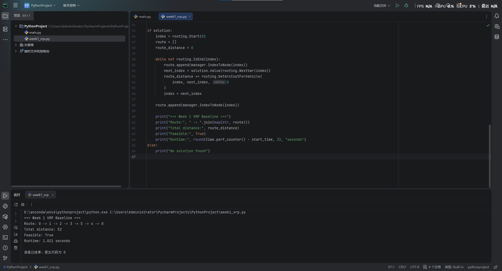

# Week 1 Checkpoint

## Team info
- Team name: Individual - VRP Project
- Members: Zichen Wang
- Date: 14 October 2026

## Environment
- [x] Environment created
- [x] Dependencies installed
- [x] Repo structure understood

**Environment details:**
- OS: Windows
- IDE: PyCharm
- Python: 3.13 (Conda environment: pythonproject)
- Solver: OR-Tools 9.15.6755
- Installation: `python -m pip install ortools` 
- Hardware: AMD Ryzen 7 5700X (8 cores, 16 threads), 32 GB RAM

## Baseline run
- [x] Baseline command executed
- [x] Objective value reported
- [x] Feasibility status reported
- [x] Evidence attached 

**Experiment results:**
- Problem: Simplified single-vehicle VRP
- Instance: 1 depot, 5 customers, 1 vehicle
- Command: `python week1_vrp.py`
- Route: 0 -> 1 -> 2 -> 3 -> 5 -> 4 -> 0
- Total distance: 52 (arbitrary units)
- Feasibility: Feasible
- Runtime: 1.021 seconds

## Reflection
1. Main setup issue: Understanding Conda environments and installing OR-Tools.
2. How it was solved: I created a Conda environment, installed OR-Tools, and successfully ran a small VRP example using PyCharm.
3. Current risk for Week 2: I need to learn how to model time-window constraints and understand more complex routing algorithms.

## Evidence

